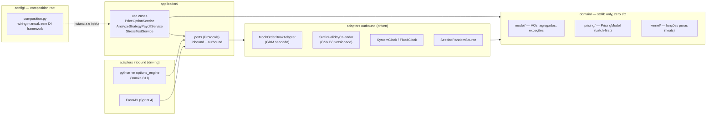

# black-scholes-pricer — Options Analytics Engine

[](https://github.com/DPontello/black-scholes-pricer/actions/workflows/ci.yml)


Motor de **precificação, simulação e gestão de risco de opções europeias** (Black-Scholes-Merton),
construído com arquitetura hexagonal e rigor de Verificação & Validação de software numérico.
O núcleo matemático é **100% stdlib** — zero dependências de runtime — e toda a precisão é
provada por testes, não presumida.

## Destaques de engenharia

- **Functional core, imperative shell** — o kernel (`bs_outputs`) é um conjunto de funções puras
  sobre floats: preço + delta, gamma, theta, vega e rho derivados de **um único** cômputo de
  intermediários (d1, d2, N(d1), descontos). CDF normal via `0.5·erfc(−x/√2)`, que preserva
  precisão relativa na cauda profunda (a forma ingênua com `erf` colapsa a 0.0 já em x ≈ −9 —
  há um teste que demonstra isso).
- **V&V em quatro camadas, cada uma com um oráculo distinto:**
  1. *Golden-master* em duas camadas — valores full-precision gerados por script independente
     (caminho de código distinto: `erf` vs `erfc`) + valores publicados (Hull, Haug) com
     tolerância = metade da última casa da fonte;
  2. *Property-based* (Hypothesis) — paridade put-call a 1e-12, bounds de não-arbitragem,
     monotonias (com as restrições de domínio corretas), convexidade em K, homogeneidade;
  3. *Fronteiras* — contrato normativo para τ=0, σ=0, underflow e entradas ilegais
     (exceções tipadas, nunca `ValueError` cru);
  4. *Diferenças finitas* — 1.620 comparações grega analítica vs derivada numérica com
     h = eps^(1/3)·escala e **piso de roundoff dependente de escala** (o ramo ascendente da
     curva em U virou código, não tolerância mágica).
- **Oráculo diferencial isolado** — reimplementação BSM independente sobre `scipy.stats.norm`,
  10.000 casos pseudo-aleatórios com seed fixa, em ambiente próprio de CI
  (`tests/oracle/requirements.txt`): **scipy nunca entra nas dependências do core**.
- **Arquitetura como regra executável** — `import-linter` no CI proíbe frameworks e libs
  numéricas no domínio. Regra que não quebra o build é sugestão, não regra.
- **Sobrevivência a revisão adversarial** — um mutante de sinal na fórmula de d1 (que passava
  por toda a suíte quando a fórmula estava duplicada) hoje é morto por 602 testes após a
  unificação em fonte única.

Alguns números verificados por máquina (Python 3.12, stdlib):

| Verificação | Resultado |
|---|---|
| Hull, Example 15.6 (S=42, K=40, r=10%, σ=20%, T=0.5) | call `4.759422`, put `0.808599` (livro publica 4.76 / 0.81) |
| Paridade put-call (erro máximo sobre o corpus) | `7.1e-15` |
| Diferença finita central — h ótimo | `eps^(1/3)·S`, erro `6.1e-12` (curva em U medida) |
| Oráculo scipy (10k casos × call/put × 6 saídas) | 120.000 comparações verdes |

## Quickstart

```bash
git clone https://github.com/DPontello/black-scholes-pricer.git && cd black-scholes-pricer
python -m venv .venv && source .venv/bin/activate   # Windows: .venv\Scripts\activate
pip install -e ".[dev,app]"  # extra `app` (FastAPI/uvicorn) só na borda; o core segue sem dependências

pytest -q                 # suíte completa (golden + propriedades + fronteiras + FD)
mypy                      # --strict em src/ e tests/
ruff check . && ruff format --check .
lint-imports              # regra de camadas (domain é stdlib-only)

# opcional — oráculo diferencial (ambiente separado de propósito):
pip install -r tests/oracle/requirements.txt
pytest -q tests/oracle/scipy_oracle.py
```

Smoke executável — documentação viva do hexágono. Precifica uma call e um iron condor de
crédito via mock GBM (relógio congelado em 2026-07-03), imprime gregas, payoff e estresse
nomeado. **Saída 100% reprodutível dada a seed** (default 42):

```bash
python -m options_engine        # seed 42
python -m options_engine 123    # outra seed, outro caminho de mercado
```

Uso do kernel:

```python
from options_engine.domain.kernel.black_scholes import bs_outputs

out = bs_outputs(s=42.0, k=40.0, tau=0.5, r=0.10, sigma=0.20, is_call=True)
out.price              # 4.759422... (Hull, Example 15.6)
out.delta              # 0.779131
out.theta_per_year     # -4.559092  — unidades canônicas no nome do campo
out.vega_per_vol_unit  # 8.813415   — por 1.00 de vol; conversões são da camada de exibição
```

## Painel de Renda (Sprint 5)

Compara venda coberta, put coberta e travas de crédito entre vários ativos, com dados de fim
de dia da B3, vol implícita por série, preço executável pelo lado certo do book e rendimento
bruto e líquido comparável ao CDI, num HTML estático ([ADR-0007](docs/adr/0007-painel-html-estatico.md)).

Os dados são baixados **manualmente** da B3 ([ADR-0006](docs/adr/0006-fontes-de-dados-de-opcoes.md)):
o COTAHIST do pregão (mais o mensal ou anual, para a vol realizada) e o Cadastro de
Instrumentos do mesmo pregão, de onde vem o estilo de exercício de cada série.

```bash
python -m options_engine painel --pregao 2026-10-23 \
    --cotahist COTAHIST_A2026.ZIP COTAHIST_D23102026.ZIP \
    --cadastro InstrumentsConsolidatedFile_20261023.csv \
    --ativos PETR4,VALE3 --saida painel.html
# opcionais: --cdi 0.15 --delta-min 0.15 --delta-max 0.35 --vencimentos 2
#            --min-negocios N --spread-max PCT --ordenar anual-liquido --acoes 100
#            --cache pregoes.sqlite --gerado-em AAAA-MM-DD
```

Para experimentar sem baixar nada, a fixture **sintética** do repositório
(`tests/data/cotahist/`, dados inventados) gera um painel completo:

```bash
python -m options_engine painel --pregao 2026-10-23 \
    --cotahist tests/data/cotahist/COTAHIST_SINTETICO_2026.TXT \
    --cadastro tests/data/cotahist/InstrumentsConsolidatedFile_20261023_SINTETICO.csv \
    --ativos PETR4,VALE3,ITUB4 --saida painel.html
```

A saída é reprodutível: a mesma entrada produz os mesmos bytes (há teste que verifica). O
ranking só tem estruturas com preço EXECUTÁVEL; referências INDICATIVO e TEÓRICO aparecem
rotuladas à parte, e tudo o que ficou de fora aparece com motivo. Cada linha do ranking tem
um gráfico de payoff recolhível (SVG inline, sem JavaScript) com o resultado bruto e o
líquido de custos e IR no vencimento, spot, strikes, breakevens e extremos.

## Arquitetura

Hexagonal (ports & adapters), com a regra de dependência apontando sempre para dentro —
verificada por contrato de camadas do `import-linter` no CI (regra que não quebra o build
é sugestão, não regra):



O motor de cálculo não sabe como os dados chegam: feeds, HTTP e persistência são adapters
plugados por ports (`Protocol`), e qualquer adapter futuro de dados de mercado nasce com a
**suíte de contrato herdável** (`tests/contract/`) como gate de conformidade. O contrato de
precificação é **batch-first** (`price_many`) desde o dia 1 — a única decisão irreversível
do projeto, tomada para que a vetorização futura (NumPy/Numba) seja troca de backend, não
reescrita.

Documentação completa em [`docs/`](docs/):

| Documento | Conteúdo |
|---|---|
| [`ARCHITECTURE.md`](docs/ARCHITECTURE.md) | Modelo de domínio, ports, tabela normativa de fronteiras, decisões ratificadas |
| [`VV-PLAN.md`](docs/VV-PLAN.md) | Política de tolerâncias, corpus golden verificado, invariantes, gates |
| [`ROADMAP.md`](docs/ROADMAP.md) | Sprints com critérios de aceite verificáveis por comando |
| [`CONVENTIONS.md`](docs/CONVENTIONS.md) | Unidades canônicas, day count (BUS/252), CDI→contínua, léxico |
| [`adr/`](docs/adr/README.md) | Architecture Decision Records (Painel de Renda: 0001–0007) |

## Status e roadmap

| Sprint | Escopo | Status |
|---|---|---|
| 1 — Fundação Matemática | Kernel BSM + gregas, V&V de 4 camadas, CI, oráculo | ✅ `v0.1.0` |
| 2 — Domínio e Simulação | VOs/agregados, estruturas (Iron Condor, Straddle), payoff/P&L, grid de estresse | ✅ `v0.2.0` |
| 3 — Ports & Adapters | Mock order book (GBM seedado), use cases, contract tests, smoke executável | ✅ `v0.3.0` |
| 5 — Painel de Renda | Volatilidade implícita, cadeia COTAHIST, venda coberta / put coberta / travas de crédito, relatório HTML | ✅ `v0.4.0` |
| App de opções (substitui a Sprint 4) | App local FastAPI + React: cotações ao vivo do Tryd (ponte RTD, também no Linux via Wine), montador, book, carteira, alertas | 🚧 semanas 1, 2 e 3, a melhoria de UX e o instalador (semana 4, parte 1; o Windows ainda a conferir num PC real) feitos (prazo 2026-11-30) |

### App de opções (em construção)

Ferramenta pessoal para dois usuários com carteiras separadas. O app não envia
ordens: você executa no home broker e registra a operação no app.

- **Desenho:** [`docs/superpowers/specs/2026-10-28-app-opcoes-design.md`](docs/superpowers/specs/2026-10-28-app-opcoes-design.md).
- **Plano da semana 1:** [`docs/superpowers/plans/2026-10-28-app-semana-1-base.md`](docs/superpowers/plans/2026-10-28-app-semana-1-base.md).
- **Semana 2 (montador e carteira):** [desenho](docs/superpowers/specs/2026-10-31-semana-2-montador-carteira-design.md),
  [plano](docs/superpowers/plans/2026-10-31-app-semana-2-montador-carteira.md) e
  [ledger](docs/superpowers/ledger-semana-2.md).
- **Semana 3 (book e análise):** [desenho](docs/superpowers/specs/2026-11-02-semana-3-book-analise-design.md),
  [plano](docs/superpowers/plans/2026-11-02-app-semana-3-book-analise.md) e
  [ledger](docs/superpowers/ledger-semana-3.md).
- **Semana 4 (instalador, IR mensal e alertas):** [desenho](docs/superpowers/specs/2026-11-03-semana-4-instalador-ir-alertas-design.md),
  [plano do instalador](docs/superpowers/plans/2026-11-03-semana-4-parte-1-instalador.md) e
  [ledger](docs/superpowers/ledger-semana-4.md).
- **Estado e como retomar:** [`docs/superpowers/HANDOFF-2026-11-02.md`](docs/superpowers/HANDOFF-2026-11-02.md).
- **Ponte do Tryd (RTD → TCP local):** [`src/options_ponte/README.md`](src/options_ponte/README.md).
  No Linux, o ambiente Wine é montado por [`scripts/linux/preparar_ponte_wine.sh`](scripts/linux/preparar_ponte_wine.sh).

#### Instalar

**Windows (64 bits).** O instalador `PainelOpcoes-<versão>-setup.exe` sai do job **Instalador**
do GitHub Actions: aba Actions → Instalador → a execução → Artifacts. Baixar exige estar logado
no GitHub, e o artefato vale por 90 dias.

O job roda:
- em tag `v*`;
- em pull request que mexe em `packaging/**`, no próprio workflow ou em `src/options_ponte/**`;
- à mão, mas o botão "Run workflow" só aparece depois que o workflow chegar à `master`.

Um push na `development` não dispara o job.

- **Instalar:** o artefato baixa como `.zip`. Extraia e dê dois cliques no `.exe`. Não pede senha
  de administrador. O programa vai para
  `%LOCALAPPDATA%\Programs\PainelOpcoes` e ganha o atalho **Painel de Opções** no menu Iniciar e,
  se marcado, na área de trabalho.
- **SmartScreen:** o instalador não é assinado, então o Windows avisa "O Windows protegeu o
  computador". Clique em **Mais informações** → **Executar assim mesmo**. Um antivírus também
  pode desconfiar do executável sem assinatura.
- **Abrir duas vezes:** o segundo clique no atalho não sobe outro programa. Ele só abre a janela
  do app que já está rodando.
- **Atualizar:** instale a versão nova por cima. Se o app estiver aberto, o instalador o fecha
  antes. Perfis, carteiras, simulações e arquivos da B3 ficam onde estão: em
  `%APPDATA%\PainelOpcoes` e na pasta de cada perfil, fora da pasta do programa.
- **Desinstalar:** pelo "Adicionar ou remover programas" (Configurações → Aplicativos), em
  **Painel de Opções**. Os dados também ficam.
- **Log:** `%APPDATA%\PainelOpcoes\logs\app.log`. Para conferir a ponte com o Tryd aberto, rode
  `ponte\PonteTryd.exe diagnostico` na pasta do programa.

**Linux.** Precisa do Python 3.12+ e do Node.js com npm. Na pasta do repositório, já na
`development`:

```bash
scripts/linux/instalar.sh             # venv em ~/.local/share/painel-opcoes, tela e atalho no menu
scripts/linux/instalar.sh --simular   # só mostra o que faria
```

A instalação aponta para a pasta do repositório (`pip install -e`).

- **Atualizar:** rode `git pull` e o script de novo.
- **Mudar a pasta de lugar ou apagá-la:** o atalho para de abrir. Rode o script de novo a partir
  da pasta nova.
- **Log:** o app aberto pelo menu não grava log em arquivo. Para ver um erro, rode
  `~/.local/share/painel-opcoes/venv/bin/python -m options_engine app` num terminal.

A ponte do Tryd continua no distrobox, montado por `preparar_ponte_wine.sh`.

#### Rodar do código

Para rodar o app (precisa do extra `app` e do Node 22+ para compilar a tela):

```bash
npm --prefix frontend ci && npm --prefix frontend run build   # gera a SPA servida pelo FastAPI
python -m options_engine app                                  # abre a janela; --sem-ponte, --sem-janela, --porta N
```

Sem o Tryd (ou sem a ponte), o app abre do mesmo jeito e mostra o fim de dia dos
arquivos da B3 importados em **Arquivos B3**, com o rótulo "Fim de dia (B3)". A
configuração fica em `%APPDATA%\PainelOpcoes` (Windows) ou `~/.config/painel-opcoes`.
A cadeia ao vivo precisa só do Cadastro de Instrumentos (o CSV ou o `pesquisa-pregao.zip` da
"Pesquisa por pregão" do Boletim Diário, como veio); o COTAHIST é opcional (fim de dia e
histórico). Os arquivos da B3 baixados para a pasta Downloads entram sozinhos
(`--sem-downloads` desliga).
No **Montador**, a estrutura sai de um dos 18 modelos prontos ou perna a perna, pela
cadeia: payoff no vencimento e hoje, gregas, breakevens, máximos brutos e líquidos de custos e
IR, a grade de cenários e a probabilidade de lucro. As simulações ficam salvas na pasta do
perfil. Na **Carteira** ficam as operações executadas na corretora: o registro (também direto
do montador), as ações que você já tem, o encerramento, o exercício e a atribuição pela regra
da Receita, o pó automático depois do vencimento e o P&L pelo preço de zerar, ao vivo ou do fim
de dia. Cada perfil grava a carteira na própria pasta, um arquivo JSON por operação.
O **Book** varre a lista do perfil no fim de dia (o último COTAHIST importado) e mostra os
5 melhores de cada estrutura nas quatro famílias: Renda (o ranking do painel de renda),
Volatilidade (iron condor, borboleta e strangle vendido com vol alta; straddle e strangle
comprados com vol baixa), Direcionais (opções baratas pela vol e, com a sua visão de alta ou
baixa, compra a seco e travas de débito para o alvo) e Proteção (put protetora e collar). Cada
item traz o critério, os números e o porquê, e abre no montador, que refaz os preços pela
cadeia do momento. Os presets (Conservador, Moderado, Arrojado) ficam salvos no perfil, com os
valores editados. No **Mercado**, a aba **Análise** mostra o fechamento e a IV de 30 dias úteis
contra a HV de 21 no último ano, o IV rank e o percentil, o smile de cada vencimento e a
estrutura a termo. O histórico de IV sai dos COTAHIST da biblioteca e fica em cache.

Para desenvolver a tela, `npm --prefix frontend run dev` (proxy para o app na 8765) e
`npm --prefix frontend run verificar` (TypeScript + Vitest).

Ao baixar os arquivos reais da B3, confira as premissas de leitura do app antes de
usá-los. O comando só lê e aponta o que não bate (TOTREG, `OptnStyle`, `ExrcPric`,
ESPECI, strike do COTAHIST × cadastro × `PEX` do Tryd):

```bash
python -m options_engine conferir-b3 --cotahist COTAHIST_A2026.ZIP --cadastro InstrumentsConsolidatedFile_AAAAMMDD.csv --pex PETRK500=48,91
```

Fora do MVP (mapeado no roadmap): dividendos discretos, exercício americano exato
(B3: opções de ações; calls já aceitas como aproximação europeia na Sprint 5), Monte Carlo,
persistência.

## Decisões de projeto (resumo)

- **float64, nunca `Decimal`** no core analítico — o erro dominante é de modelo, não de representação.
- **Convenções como parâmetro, nunca constante** — day count default BUS/252 (B3), theta por ano,
  vega por 1.00 de vol; toda assinatura pública carrega a unidade no nome do campo.
- **Tolerância pertence ao oráculo** — cada camada de teste tem tolerância derivada da proveniência
  do valor esperado e da física do erro em ponto flutuante (`tests/_tolerances.py`; nenhuma inline).
- **Determinismo total** — clock e aleatoriedade injetados, seeds fixas, golden-masters imutáveis
  por convenção (corrigir exige nova verificação registrada no commit).
