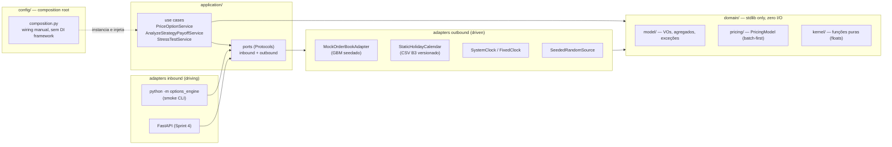

# black-scholes-pricer — Options Analytics Engine

[](https://github.com/DPontello/black-scholes-pricer/actions/workflows/ci.yml)


Motor de **precificação, simulação e gestão de risco de opções europeias** (Black-Scholes-Merton),
construído com arquitetura hexagonal e rigor de Verificação & Validação de software numérico.
O núcleo matemático é **100% stdlib** — zero dependências de runtime — e toda a precisão é
provada por testes, não presumida.

## Destaques de engenharia

- **Functional core, imperative shell** — o kernel (`bs_outputs`) é um conjunto de funções puras
  sobre floats: preço + delta, gamma, theta, vega e rho derivados de **um único** cômputo de
  intermediários (d1, d2, N(d1), descontos). CDF normal via `0.5·erfc(−x/√2)`, que preserva
  precisão relativa na cauda profunda (a forma ingênua com `erf` colapsa a 0.0 já em x ≈ −9 —
  há um teste que demonstra isso).
- **V&V em quatro camadas, cada uma com um oráculo distinto:**
  1. *Golden-master* em duas camadas — valores full-precision gerados por script independente
     (caminho de código distinto: `erf` vs `erfc`) + valores publicados (Hull, Haug) com
     tolerância = metade da última casa da fonte;
  2. *Property-based* (Hypothesis) — paridade put-call a 1e-12, bounds de não-arbitragem,
     monotonias (com as restrições de domínio corretas), convexidade em K, homogeneidade;
  3. *Fronteiras* — contrato normativo para τ=0, σ=0, underflow e entradas ilegais
     (exceções tipadas, nunca `ValueError` cru);
  4. *Diferenças finitas* — 1.620 comparações grega analítica vs derivada numérica com
     h = eps^(1/3)·escala e **piso de roundoff dependente de escala** (o ramo ascendente da
     curva em U virou código, não tolerância mágica).
- **Oráculo diferencial isolado** — reimplementação BSM independente sobre `scipy.stats.norm`,
  10.000 casos pseudo-aleatórios com seed fixa, em ambiente próprio de CI
  (`tests/oracle/requirements.txt`): **scipy nunca entra nas dependências do core**.
- **Arquitetura como regra executável** — `import-linter` no CI proíbe frameworks e libs
  numéricas no domínio. Regra que não quebra o build é sugestão, não regra.
- **Sobrevivência a revisão adversarial** — um mutante de sinal na fórmula de d1 (que passava
  por toda a suíte quando a fórmula estava duplicada) hoje é morto por 602 testes após a
  unificação em fonte única.

Alguns números verificados por máquina (Python 3.12, stdlib):

| Verificação | Resultado |
|---|---|
| Hull, Example 15.6 (S=42, K=40, r=10%, σ=20%, T=0.5) | call `4.759422`, put `0.808599` (livro publica 4.76 / 0.81) |
| Paridade put-call (erro máximo sobre o corpus) | `7.1e-15` |
| Diferença finita central — h ótimo | `eps^(1/3)·S`, erro `6.1e-12` (curva em U medida) |
| Oráculo scipy (10k casos × call/put × 6 saídas) | 120.000 comparações verdes |

## Quickstart

```bash
git clone https://github.com/DPontello/black-scholes-pricer.git && cd black-scholes-pricer
python -m venv .venv && source .venv/bin/activate   # Windows: .venv\Scripts\activate
pip install -e ".[dev]"

pytest -q                 # suíte completa (golden + propriedades + fronteiras + FD)
mypy                      # --strict em src/ e tests/
ruff check . && ruff format --check .
lint-imports              # regra de camadas (domain é stdlib-only)

# opcional — oráculo diferencial (ambiente separado de propósito):
pip install -r tests/oracle/requirements.txt
pytest -q tests/oracle/scipy_oracle.py
```

Smoke executável — documentação viva do hexágono. Precifica uma call e um iron condor de
crédito via mock GBM (relógio congelado em 2026-07-03), imprime gregas, payoff e estresse
nomeado. **Saída 100% reprodutível dada a seed** (default 42):

```bash
python -m options_engine        # seed 42
python -m options_engine 123    # outra seed, outro caminho de mercado
```

Uso do kernel:

```python
from options_engine.domain.kernel.black_scholes import bs_outputs

out = bs_outputs(s=42.0, k=40.0, tau=0.5, r=0.10, sigma=0.20, is_call=True)
out.price              # 4.759422... (Hull, Example 15.6)
out.delta              # 0.779131
out.theta_per_year     # -4.559092  — unidades canônicas no nome do campo
out.vega_per_vol_unit  # 8.813415   — por 1.00 de vol; conversões são da camada de exibição
```

## Arquitetura

Hexagonal (ports & adapters), com a regra de dependência apontando sempre para dentro —
verificada por contrato de camadas do `import-linter` no CI (regra que não quebra o build
é sugestão, não regra):



O motor de cálculo não sabe como os dados chegam: feeds, HTTP e persistência são adapters
plugados por ports (`Protocol`), e qualquer adapter futuro de dados de mercado nasce com a
**suíte de contrato herdável** (`tests/contract/`) como gate de conformidade. O contrato de
precificação é **batch-first** (`price_many`) desde o dia 1 — a única decisão irreversível
do projeto, tomada para que a vetorização futura (NumPy/Numba) seja troca de backend, não
reescrita.

Documentação completa em [`docs/`](docs/):

| Documento | Conteúdo |
|---|---|
| [`ARCHITECTURE.md`](docs/ARCHITECTURE.md) | Modelo de domínio, ports, tabela normativa de fronteiras, decisões ratificadas |
| [`VV-PLAN.md`](docs/VV-PLAN.md) | Política de tolerâncias, corpus golden verificado, invariantes, gates |
| [`ROADMAP.md`](docs/ROADMAP.md) | Sprints com critérios de aceite verificáveis por comando |
| [`CONVENTIONS.md`](docs/CONVENTIONS.md) | Unidades canônicas, day count (BUS/252), CDI→contínua, léxico |
| [`adr/`](docs/adr/README.md) | Architecture Decision Records (Painel de Renda: 0001–0007) |

## Status e roadmap

| Sprint | Escopo | Status |
|---|---|---|
| 1 — Fundação Matemática | Kernel BSM + gregas, V&V de 4 camadas, CI, oráculo | ✅ `v0.1.0` |
| 2 — Domínio e Simulação | VOs/agregados, estruturas (Iron Condor, Straddle), payoff/P&L, grid de estresse | ✅ `v0.2.0` |
| 3 — Ports & Adapters | Mock order book (GBM seedado), use cases, contract tests, smoke executável | ✅ `v0.3.0` |
| 5 — Painel de Renda | Volatilidade implícita, cadeia COTAHIST, venda coberta / put coberta / travas de crédito, relatório HTML | próxima ([ADR-0001](docs/adr/0001-renda-antes-da-api.md)) |
| 4 — API e Portfólio | FastAPI como adapter fino, benchmark, ADRs | após a Sprint 5 |

Fora do MVP (mapeado no roadmap): dividendos discretos, exercício americano exato
(B3: opções de ações; calls já aceitas como aproximação europeia na Sprint 5), Monte Carlo,
persistência. Implied vol entra na Sprint 5.

## Decisões de projeto (resumo)

- **float64, nunca `Decimal`** no core analítico — o erro dominante é de modelo, não de representação.
- **Convenções como parâmetro, nunca constante** — day count default BUS/252 (B3), theta por ano,
  vega por 1.00 de vol; toda assinatura pública carrega a unidade no nome do campo.
- **Tolerância pertence ao oráculo** — cada camada de teste tem tolerância derivada da proveniência
  do valor esperado e da física do erro em ponto flutuante (`tests/_tolerances.py`; nenhuma inline).
- **Determinismo total** — clock e aleatoriedade injetados, seeds fixas, golden-masters imutáveis
  por convenção (corrigir exige nova verificação registrada no commit).
